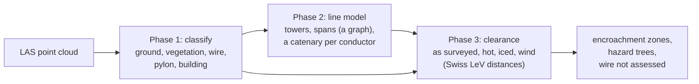

# Tree-to-line clearance from LiDAR

[](https://github.com/KingDanielE/lidar-clearance/actions/workflows/ci.yml)

How close is the vegetation to a power line, and will it still be clear on a hot day or in
a strong wind? This pipeline answers that from a raw LiDAR point cloud. It is plain Python
(NumPy, SciPy, laspy), rule-based and physics-based, with no trained model, and is checked
against hand-labelled drone LiDAR of high-voltage lines in Switzerland
([GridNet-HD](#data-and-credit)).



- **Phase 1** classifies every point (ground filter, eigenvalue features, rules on 0.15 m
  voxels).
- **Phase 2** finds the towers (from steel, from kinks and turns in the wires, and at line
  ends), builds a graph of towers and spans, so a tile may hold several lines and
  junctions, and fits a catenary to every conductor.
- **Phase 3** carries each conductor to 40 C, to 0 C with ice and to a 500 N/m2 wind with
  the change-of-state equation, measures the 3D distance to every vegetation point against
  the Swiss Leitungsverordnung (LeV) distances, and reports tiered encroachment zones,
  trees that could fall into the line, and any wire it could not model (so the vegetation
  beside it is reported as not assessed rather than clear).

How it works: [docs/method.md](docs/method.md). Every score: [docs/validation.md](docs/validation.md).

## Results at a glance

Phase 3 is scored **end to end**: the reference is a run built entirely from the hand labels
(conductor model fitted to the hand-labelled wire, hand-labelled vegetation), compared
point by point with ours.

**Held-out tests**, run on frozen code before the tile was ever looked at:

| | t1z8 (forest, 51 M points), code `d651e4b` | t4z1 (forest, 103 M points), code `29cff99` |
|---|---|---|
| 1. Wires found (recall / IoU) | 99.5% / 0.82 | 97.5% / 0.70 |
| 2. Towers / conductors (hand labels) | 2 / 15 (2 / 15), within 0.1 cm | **crashed** (a diverging fit raised inside SciPy) |
| 3. Encroachment zones | **34 of 34, no false ones, all in the same tier** (3 m placeholder threshold) | no result |
| 3. Flagged vegetation points (precision / recall) | 99.9% / 100% | no result |
| 3. Hazard trees (precision / recall) | 98% / 96% | no result |

The t4z1 crash, and the false towers and false violation that canopy labelled as wire
caused once it was fixed, led to the Phase 2 changes listed in [validation](docs/validation.md#phase-2-conductor-model).
t4z1 is therefore no longer held out; it is in the table below with the other tiles worked on.

**Current version, Swiss rules** (380 kV: 5.3 m to trees in the hot and ice cases, 3.8 m in
wind):

| | t1z8: forest | t1z6a: forest | t2z5: junction | t4z1: forest | t5b6: alpine |
|---|---|---|---|---|---|
| Points | 51 M | 50 M | 67 M | 103 M | 36 M |
| 1. Wires found (recall / IoU) | 99% / 0.82 | 99% / 0.69 | 99% / 0.81 | 97% / 0.70 | 97% / 0.79 |
| 2. Towers found (true towers) | 2 (2) | 3 (3) | 6 (6) | 4 (4) | 2 (2) |
| 2. Conductors (hand-label model) | 15 (15) | 20 (21) | 48 (46) | 34 (35) | 22 (22) |
| 3. Closest vegetation as surveyed (hand labels) | 2.80 m (2.80) | 1.17 m (1.17) | 1.21 m (1.21) | 3.65 m (3.65) | 8.39 m (8.39) |
| 3. Zones: ours (reference) | 63 (63) | 43 (44) | 75 (76) | 62 (64) | 1 (1) |
| 3. Zones precision / recall / same tier | **100% / 100% / 63 of 63** | 100% / 98% / 43 of 43 | 99% / 100% / 74 of 77 | 100% / 97% / 62 of 62 | 100% / 100% / 1 of 1 |
| 3. Flagged vegetation points (precision / recall) | 99.9% / 100% | 97% / 97% | 97% / 97% | 99.9% / 99.6% | 100% / 100% |
| 3. Hazard trees (precision / recall) | 97% / 97% | 88% / 97% | 89% / 96% | 91% / 92% | none exist |
| 3. Wire not modelled (vegetation beside it not assessed) | none | 12 m | 235 m (no vegetation near) | 123 m (canopy labelled wire) | none |

- **t1z8** is held out only in the first table; here it runs with everything since.
- **t1z6a**, **t2z5** and **t4z1** were all fixed on, so they are not held out. At the
  t2z5 junction the reference is weak too: it is our own Phase 2 on the hand-labelled
  points, and it fails to model some conductors that we model from hand-labelled wire.
- Two neighbouring tiles (t1z6a + t1z6b, 102 M points) can be joined into one run, so spans
  cut by the tile edge are whole ([validation](docs/validation.md#joining-neighbouring-tiles)).

**Phase 1**: predicted classes (top) against the hand labels (bottom), along the line.


**Phase 2**: catenaries (black) fitted to each conductor's points, per span: a double
circuit (2 x 3 phases) plus an earth wire.


**Phase 3**: the held-out forest line, Swiss rules. Vegetation coloured by its worst case
(as surveyed, hot at 40 C, iced, or swung by wind) against the required distance: red is
inside it, orange within 1.5 m of it, yellow on the 3-year watch list.


Cross-section at the worst zone: each conductor as surveyed (black), hot (red), iced
(violet) and swung 44 degrees by a 500 N/m2 wind (blue), with the required distances (5.3 m
hot and iced, 3.8 m in wind). In wind the conductors swing about 5 m sideways; the lower
one on the left comes to 0.22 m from the tallest crowns.


## Run

```bash
uv venv --python 3.12 .venv
uv pip install --python .venv -r requirements.txt -e .
.venv/Scripts/python -m pytest   # Windows path; bin/ on macOS/Linux
```

Get the GridNet-HD tiles used here (1.2-4.3 GB each; see [Data and credit](#data-and-credit)).
Large downloads from Hugging Face sometimes drop; `-C -` resumes them.

```bash
mkdir -p data
for z in t5c2 t5b6 t1z6a t1z6b t1z8 t2z5 t4z1; do curl -L -C - -o data/$z.las https://huggingface.co/datasets/heig-vd-geo/GridNet-HD/resolve/main/$z/lidar/$z.las; done
```

Run all three phases on one or more tiles, with a summary row per tile in
`out/batch_summary.md`. `a.las+b.las` joins neighbouring tiles into one run:

```bash
clearance-batch data/t1z8.las data/t1z6a.las+data/t1z6b.las --truth-field ground_truth --truth-map gridnet
```

Phase 3 takes `--kv`, `--t-survey`, `--t-max` and `--wind-pa` (defaults 380 kV, 15 C, 40 C,
500 Pa). Each phase also runs on its own: `clearance-phase1 <tile.las>`, then
`clearance-phase2` and `clearance-phase3` on the `<name>_classified_voxels.las` Phase 1
writes. `clearance-screen --remote <zone>` reads about 2% of a remote tile by HTTP byte
range and reports how close hand-labelled vegetation comes to the wires, to pick tiles
worth downloading. The same commands run as `python -m scripts.run_batch` and so on.

Outputs per tile, in `out/<name>/`: encroachment zones (CSV and GeoJSON), hazard trees,
unmodelled wire (CSV), the classified cloud and the vegetation coloured by clearance (LAS),
JSON reports and plots.

## Data and credit

The LiDAR data is [GridNet-HD](https://huggingface.co/datasets/heig-vd-geo/GridNet-HD)
(HEIG-VD), licensed [CC BY 4.0](https://creativecommons.org/licenses/by/4.0/): UAV LiDAR
and imagery of high-voltage lines with per-point labels. This project uses zones t5c2
(30.6 M points, 268 x 581 m, 236 m relief), t5b6 (36.1 M points, 328 x 747 x 223 m), t1z6a
(50.3 M points, 213 x 610 x 91 m, forest), t1z6b (51.5 M points, 238 x 614 x 105 m, the
neighbour of t1z6a), t1z8 (50.6 M points, 216 x 683 x 83 m, forest, validation split), t2z5
(66.7 M points, 515 x 680 x 162 m, a line junction) and t4z1 (102.8 M points,
260 x 934 x 375 m, forest). The data is not included in this repository, and the plots in
`docs/` are derived from it.

> Antoine Carreaud, Shanci Li, Malo De Lacour, Digre Frinde, Jan Skaloud, Adrien Gressin.
> *GridNet-HD: A High-Resolution Multi-Modal Dataset for LiDAR-Image Fusion on Power Line
> Infrastructure.* arXiv:2601.13052, 2026. https://arxiv.org/abs/2601.13052

## Licence

Code: [MIT](LICENSE). Data and the plots derived from it: GridNet-HD, CC BY 4.0 (see
[Data and credit](#data-and-credit)).
