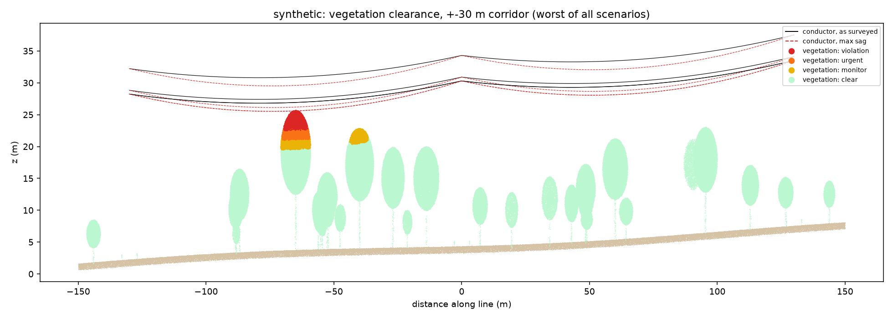
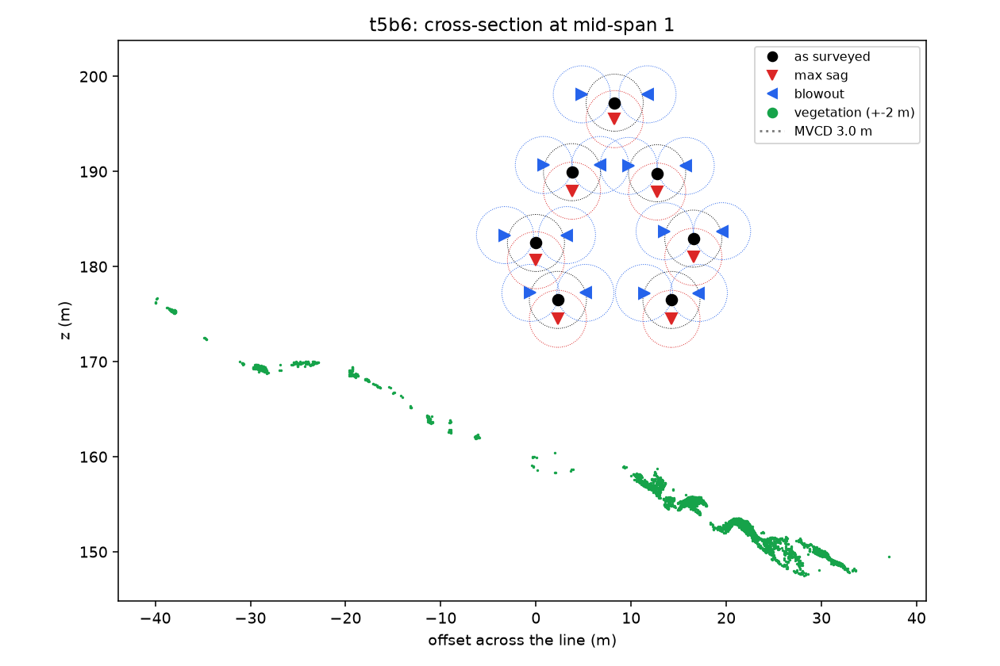

# Tree-to-line clearance from LiDAR

How close is the vegetation to a power line, and will it still be clear on a hot day or in
a strong wind? This pipeline answers that from a raw LiDAR point cloud, in three phases:

- **Phase 1**: classify the cloud into ground, vegetation, wires, pylons and buildings.
- **Phase 2**: find the towers, split the line into spans and fit a catenary to every
  conductor.
- **Phase 3**: vegetation clearance as surveyed, at max sag and in wind blowout; tiered
  encroachment zones; hazard (fall-in) trees.

Plain Python (NumPy, SciPy, laspy), rule-based and physics-based, no trained model. Checked
against hand-labelled drone LiDAR of a high-voltage line in the Alps
([GridNet-HD](#data-and-credit)), on a tile used for tuning and a held-out one.

## Results at a glance

On the held-out tile (t5b6, 36 M points, parameters not tuned on it):

| Phase | Result |
|---|---|
| 1. Classification | wire recall 97% (IoU 0.79), pylon IoU 0.87, ground IoU 0.97 |
| 2. Conductor model | 21 of 21 conductors found; fit RMSE 3.0-5.5 cm; within 3.8 cm of a fit to the hand labels |
| 3. Clearance | closest vegetation 9.87 m as surveyed, 8.05 m at max sag; same as with the hand labels |

**Phase 1**: predicted classes (top) against the hand labels (bottom), along the line.


**Phase 2**: catenaries (black) fitted to each conductor's points, per span: a double
circuit (2 x 3 phases) plus an earth wire.


**Phase 3**: clearance on a synthetic corridor with known trees (the real line is clear).
The tall tree near mid-span violates the 3 m clearance once the conductor sags at 80 C
(dashed red); the next one is on the watch list.



Cross-section of the real line at mid-span: each conductor as surveyed (black), at max sag
(red) and swung by wind (blue), with the 3 m clearance circles.



## Run

```bash
uv venv --python 3.12 .venv
uv pip install --python .venv -r requirements.txt
.venv/Scripts/python -m pytest   # Windows path; bin/ on macOS/Linux
```

Get the two GridNet-HD tiles (1.2 and 1.4 GB, see [Data and credit](#data-and-credit)):

```bash
mkdir -p data
curl -L -o data/t5c2.las https://huggingface.co/datasets/heig-vd-geo/GridNet-HD/resolve/main/t5c2/lidar/t5c2.las
curl -L -o data/t5b6.las https://huggingface.co/datasets/heig-vd-geo/GridNet-HD/resolve/main/t5b6/lidar/t5b6.las
```

Run the three phases on a tile (or `run_phase1 --synthetic` for the generated corridor):

```bash
.venv/Scripts/python -m scripts.run_phase1 data/t5c2.las --truth-field ground_truth --truth-map gridnet --out out/t5c2
.venv/Scripts/python -m scripts.run_phase2 out/t5c2/t5c2_classified_voxels.las --out out/t5c2
.venv/Scripts/python -m scripts.run_phase3 out/t5c2/t5c2_classified_voxels.las --out out/t5c2 [--mvcd 3 --t-max 80 --wind-pa 300]
```

Phase 1 writes `<name>_report.md/.json` (scores + confusion matrix), `<name>_plan.png`,
`<name>_profile.png` (predicted vs truth along the line), `<name>_3d.png`, and
`<name>_classified_voxels.las` (open in CloudCompare), which Phases 2 and 3 read.

## Data and credit

The LiDAR data is [GridNet-HD](https://huggingface.co/datasets/heig-vd-geo/GridNet-HD)
(HEIG-VD), licensed [CC BY 4.0](https://creativecommons.org/licenses/by/4.0/): UAV LiDAR
and imagery of high-voltage lines with per-point labels. This project uses zones t5c2
(30.6 M points, 268 x 581 m, 236 m relief) and t5b6 (36.1 M points, 328 x 747 x 223 m). The
data is not included in this repository, and the plots in `docs/` are derived from it.

> Antoine Carreaud, Shanci Li, Malo De Lacour, Digre Frinde, Jan Skaloud, Adrien Gressin.
> *GridNet-HD: A High-Resolution Multi-Modal Dataset for LiDAR-Image Fusion on Power Line
> Infrastructure.* arXiv:2601.13052, 2026. https://arxiv.org/abs/2601.13052

## Phase 1: classification (`ground.py`, `features.py`, `classify.py`)

1. `io.voxel_downsample`: 0.15 m voxels (30.6 M -> 5.5 M points); labels are copied back
   to every original point at the end.
2. `ground.pmf_dtm`: progressive morphological filter on a 0.5 m min-z raster -> DTM ->
   height above ground (HAG). Points under 0.5 m HAG are ground.
3. `features`: eigenvalue features over 16 neighbours (linearity, planarity, scattering,
   main-direction and normal z) and `gap_below`, the empty space under each point's
   vertical run in its 0.5 m column.
4. `classify`:
   - **wires**: HAG > 3 m, linear, main direction < ~37 deg from horizontal, > 1 m of air
     below; clusters must be >= 15 m long and 4x longer than wide. Then short pieces aligned
     with nearby wires (sparse spans) and region growing into linear neighbours.
   - **pylons**: clusters >= 10 m tall, scattering < 0.14 (lattice, not crown), top within
     3 m of a wire and at least as high as the wires there. Points more than 15 m from the
     tower centre are handed back (wires the voxel grid joined to the tower).
   - **buildings**: smooth (scattering < 0.05) mostly planar clusters, >= 2 m wide.
   - **vegetation**: everything else above ground.

### Results on t5c2 (tuning tile)

Full resolution, every point scored against GridNet-HD labels (grass, rock, road -> ground;
insulators -> pylon; conductors and structural cables -> wire).

| class | precision | recall | IoU |
|---|---:|---:|---:|
| ground | 0.990 | 0.997 | 0.987 |
| vegetation | 0.420 | 0.738 | 0.365 |
| building | 1.000 | 0.582 | 0.582 |
| pylon | 0.991 | 0.952 | 0.944 |
| wire | 0.965 | 0.982 | 0.948 |

Overall accuracy 0.983; runtime about 1 minute on a laptop.

### Held-out check: t5b6 (thresholds unchanged)

Zone t5b6 (36.1 M points, 328 x 747 x 223 m, bigger towers, more trees) was never looked at
while tuning. Same parameters:

| class | precision | recall | IoU | (t5c2 IoU) |
|---|---:|---:|---:|---:|
| ground | 0.990 | 0.977 | 0.968 | 0.987 |
| vegetation | 0.632 | 0.781 | 0.537 | 0.365 |
| building | 0.000 | 0.000 | 0.000 | 0.582 |
| pylon | 0.939 | 0.918 | 0.867 | 0.944 |
| wire | 0.803 | 0.974 | 0.786 | 0.948 |

- Wire recall holds (97%); precision drops to 80%. The false wires are mostly pylon members
  (38k points): these towers are wider than the 15 m `pylon_radius`, so their outer parts are
  handed back as wires. 7k vegetation points also became wire.
- The tile has almost no buildings (9k points); the 62k "building" predictions are smooth
  ground and rock above the DTM.
- Phase 2 absorbs the wire false positives (see below), so the geometry is unaffected. For a
  Phase 1 fix: size `pylon_radius` from each tower's own footprint instead of a constant.

Caveats:
- t5c2 numbers are tuned-on-the-data; t5b6 is the honest estimate.
- Vegetation here is tiny (0.7% of points, mostly shrubs under 1 m), so its precision is
  dominated by rough ground and building edges labelled vegetation. Low vegetation can't
  reach the wires; Phase 3 should only consider vegetation above a few metres.
- A tree that has grown into the wires could be absorbed into a pylon cluster only if it is
  also lattice-smooth and within 15 m of a tower; worth a dedicated check in Phase 3.

## Phase 2: conductor model (`clearance/spans.py`, `clearance/catenary.py`)

1. **Towers**: connected clusters of pylon points (>= 200 voxels); pieces within 10 m of
   each other are one tower. Centre = median xy.
2. **Spans**: a route through the tower centres, ordered along the line, extended past the
   end towers to where the wire points stop (tiles cut spans off). Each wire point goes to
   the nearest route segment in plan view. Spans between two towers are *full*, the rest
   *partial*.
3. **Conductors**: in each span, cluster (DBSCAN, eps 0.5 m) on lateral offset and height
   above a common quadratic. Parallel wires keep a constant offset, so each collapses to a
   blob however patchy it is along the span. Bundled sub-conductors stay one conductor.
   Points within 3 m of a tower are left out first: clamps, insulator strings and jumpers
   hang there and bend away from the catenary.
4. **Catenary** per conductor, in its own vertical plane:
   `z(u) = z0 + c (cosh((u - u0)/c) - 1)`, robust least squares (soft-L1, 10 cm scale),
   started from a parabola fit, then up to two refits without points more than
   max(0.5 m, 3 robust sigma) off. `c = H/w` (horizontal tension / weight per metre).
   Reported: c, sag below the chord (full spans), fit RMSE (vertical and lateral), coverage,
   lowest ground clearance along the wire, outliers dropped.
5. **Validation**: a cluster is rejected (listed with the reason in the report) if it has
   < 100 points, is < 10 m long, covers < 50% of its extent, has c at a fit bound, a
   vertical RMSE > 25 cm (real conductors fit to ~5 cm), or did not converge. This is what
   removes the clusters made of Phase 1's false wire points.
6. Outputs: `<name>_phase2.json`, `<name>_conductors.csv`, `<name>_conductor_model.las`
   (every conductor sampled at 0.25 m, the input for Phase 3), `<name>_spans.png`
   (points + fitted curves per span), `<name>_route.png` (plan).

### Results

Both tiles: 2 towers, 3 spans (one full span, two cut off by the tile edge), 7 conductors in
every span: a double circuit (2 x 3 phases) plus an earth wire.

| | t5c2 | t5b6 (held out) |
|---|---|---|
| full span length | 191 m | 239 m |
| sag (full span) | 4.05-4.31 m | 6.12-7.36 m |
| c (full span) | 1084-1155 m | 987-1184 m |
| vertical RMSE, all conductors | 2.8-5.0 cm | 3.0-5.5 cm |
| lowest ground clearance | 10.5 m | 10.8 m |
| clusters rejected | 1 (18 pts) | 17 (Phase 1 false wires) |
| conductors matching the truth-label model | 21 / 21 | 21 / 21 |
| max height difference to the truth-label model | 1.7 cm | 3.8 cm |

**Classification errors barely move the geometry**: even on t5b6, where 20% of predicted
wire points are wrong, every conductor fitted from predicted points is within 3.8 cm of the
one fitted from hand-labelled points. On partial spans c itself can differ by a few percent
(a 40-130 m piece of a span constrains it weakly) while the curve over the covered stretch
still agrees to centimetres.

Note: the tower margin, residual trim and validation rules were added after the first
t5b6 run showed tower hardware and false wires spoiling fits, so Phase 2's t5b6 numbers are
no longer strictly held out. Phase 1's t5b6 numbers are.

Synthetic check (tests): c = 900 m and sag 2.35 m are recovered within 3% and 5 cm.

### Limits

- Partial spans: the model is only valid over the stretch with points; c is weakly
  determined. Joining neighbouring tiles fixes this.
- Bundled conductors are modelled at the bundle centre; Phase 3 should subtract the
  bundle radius.
- One line per tile is assumed (the route is one polyline). Parallel lines would need
  tower-to-tower matching per line.
- The fit is the line *as surveyed*. Max sag (hot conductor) and blowout (wind) are Phase 3.

## Phase 3: vegetation clearance (`scenarios.py`, `encroach.py`, `hazard.py`)

1. **Scenarios** per conductor, sampled every 0.1 m over its modelled extent:
   - *as surveyed*: the Phase 2 catenary.
   - *max sag*: the wire at `t_max` (80 C) is longer by `alpha * dT` (ACSR, 19.3e-6 /C);
     the new catenary through the same attachment points with that arc length is solved
     exactly. Elastic relief (a hot wire's lower tension) is ignored, which overstates sag
     a little: the safe side. A sag-tension tool (PLS-CADD, ruling span) is the production
     replacement.
   - *blowout left / right*: the curve (at `t_wind`) swings rigidly about its chord by
     `theta = atan(wind pressure * diameter / weight)` (28 deg with the defaults).
   - Partial spans: the far attachment is extrapolated along the fitted curve at the
     median full-span length, so their sag and blowout positions are flagged `estimated`.
2. **Vegetation cleaning** (Phase 1 errors would otherwise become false alarms):
   - *floating fragments*: vegetation clusters (1 m connectivity) with < 200 points and
     nothing below 3 m above ground. Plants grow from the ground; on both real tiles every
     false zone they caused was hand-labelled conductor.
   - *on-conductor points*: within 0.5 m of the conductor model with >= 80% of their 1 m
     neighbourhood also on it. A crown touching the wire keeps its contact points (the
     crown behind them is in their neighbourhood); tested.
3. **Clearance**: 3D distance from each vegetation point to the nearest conductor sample, per
   scenario; the worst scenario sets the tier:
   `violation < MVCD <= urgent < MVCD + 1.5 m <= monitor < MVCD + growth * cycle`.
4. **Encroachment zones**: flagged points clustered (1 m connectivity); per zone the tier,
   worst scenario, min clearance in every scenario, nearest span/conductor, horizontal and
   vertical offset, location, point count, plan area, years to violation. Sorted worst first.
5. **Hazard trees**: treetops = local maxima (3 m window) of a 0.5 m canopy height model,
   >= 3 m tall. A vertical tree pivoting at its base reaches its height: `strike` if
   height > distance from base to the nearest conductor (any scenario), `within_mvcd` if it
   falls within MVCD of it. Leaning, crown width and downhill falls are not modelled.
6. Outputs: `<name>_phase3.json`, `<name>_encroachments.csv` / `.geojson` (zone hulls, in
   the tile's projected CRS: assign it in GIS), `<name>_hazard_trees.csv`,
   `<name>_vegetation_clearance.las` (fields `clearance`, `tier`), plots `_clearance_profile`,
   `_clearance_plan`, `_clearance_section` (cross-section at the worst zone, or mid-span).

All thresholds and conductor data are **placeholders** (`Rules`, `LineParams`): MVCD 3 m,
growth 1 m/yr over a 3-year cycle, survey 15 C, max 80 C, 300 Pa wind, ACSR Zebra-like
conductor. Set them from the utility's standard and the line's design data.

### Results

| | synthetic | t5c2 | t5b6 |
|---|---|---|---|
| min clearance as surveyed / max sag / blowout | 1.57 / 0.32 / 1.59 m | 9.26 / 7.64 / 9.31 m | 9.87 / 8.05 / 10.10 m |
| same, hand-labelled vegetation | 1.57 / 0.32 / 1.59 m | 12.07 / 11.00 / 12.33 m | 9.87 / 8.05 / 10.10 m |
| zones (violation / urgent / monitor) | 1 / 0 / 1 | 0 | 0 |
| hazard trees (strike / within MVCD) | 0 / 1 | 0 / 0 | 0 / 0 |
| closest tree to reaching a conductor | | 14.6 m short | 7.9 m short |
| vegetation points dropped (floating / on conductor) | 0 / 1 | 130 / 0 | 355 / 0 |

- Synthetic: the 22 m tree planted 4 m off the line is a violation at max sag (0.32 m;
  1.57 m as surveyed), the 19 m tree is on the watch list (4.56 m, ~1.6 years at 1 m/yr).
  Tests check the hot-wire sag against the parabolic formula, the blowout swing against
  `s sin(theta)`, and the fall-in rule.
- Real tiles: the line is well clear (closest vegetation 8 m at max sag). Before the
  vegetation cleaning, t5c2 showed 3 zones and t5b6 8 zones plus 10 "strike" trees. Every
  zone was hand-labelled conductor points that Phase 1 called vegetation; the "trees" were
  20-43 m tall peaks at wire height, most within 10 m of a tower. After cleaning, the
  predicted-vegetation results equal the hand-labelled ones on t5b6 and are 2.8 m more
  conservative on t5c2 (ground/rock points labelled vegetation, not on the line).
- Max sag cuts the closest clearance by ~1.8 m on the 239 m span; with vegetation below the
  wires, blowout lifts them away, so max sag is the governing case here.

### Limits

- No real encroachment exists in these two tiles, so the zone and hazard logic is verified
  on the synthetic scene and by tests only. A tile with trees under the line is the next
  check.
- One survey temperature for the whole flight; no conductor creep; no ice load.
- Clearance is to the conductor centreline (`conductor_radius_m` = 0; set the bundle radius).

## Licence

Code: [MIT](LICENSE). Data and the plots derived from it: GridNet-HD, CC BY 4.0 (see
[Data and credit](#data-and-credit)).
