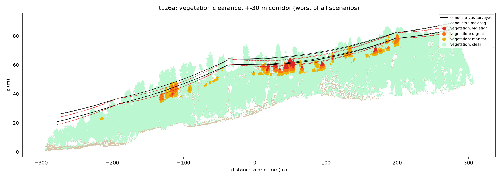
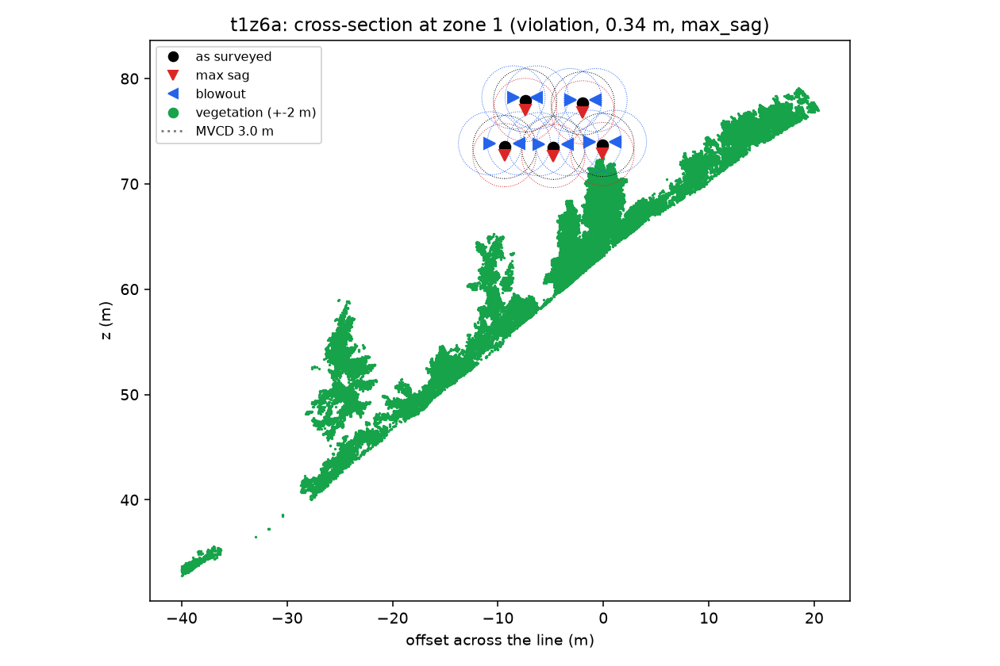

# Tree-to-line clearance from LiDAR

How close is the vegetation to a power line, and will it still be clear on a hot day or in
a strong wind? This pipeline answers that from a raw LiDAR point cloud, in three phases:

- **Phase 1**: classify the cloud into ground, vegetation, wires, pylons and buildings.
- **Phase 2**: find the towers, build a graph of towers and the spans between them (several
  lines and junctions per tile), and fit a catenary to every conductor.
- **Phase 3**: vegetation clearance as surveyed, at max sag and in wind blowout; tiered
  encroachment zones; hazard (fall-in) trees.

Plain Python (NumPy, SciPy, laspy), rule-based and physics-based, no trained model. Checked
against hand-labelled drone LiDAR of high-voltage lines ([GridNet-HD](#data-and-credit)):
two alpine tiles, a forest tile with trees growing into the line, and a tile on another
line with a junction (several towers 15-30 m apart where lines meet).

## Results at a glance

Every number is scored against the dataset's hand labels. Phase 3 is scored **end to end**:
the reference is a run built entirely from the hand labels (conductor model fitted to the
hand-labelled wire, hand-labelled vegetation), compared point by point with our run.

| | t5b6: alpine, held out | t1z6a: forest | t2z5: junction |
|---|---|---|---|
| Points | 36 M | 50 M | 67 M |
| 1. Wires found (recall / IoU) | 97% / 0.79 | 99% / 0.69 | 99% / 0.81 |
| 2. Towers found (true towers) | 2 (2), within 0.1 m | 3 (3), within 0.7 m | **6 (6), within 2.6 m** |
| 2. Conductors (hand-label model) | 22 (22) | 21 (21) | 39 (35) |
| 2. Fit RMSE / median distance to the hand-label fit | 3-6 cm / 0.5 cm | 3-4 cm / 0.0 cm | 2-20 cm / 0.3 cm |
| 3. Closest vegetation as surveyed (hand labels) | 8.4 m (8.4 m) | 0.7 m (1.2 m) | 1.2 m (1.2 m) |
| 3. Encroachment zones (precision / recall) | none exist | **98% / 100%** (46 zones) | 85% / 96% (49 zones) |
| 3. Flagged vegetation points (precision / recall) | - | 92% / 100% | 86% / 91% |
| 3. Hazard trees (precision / recall) | none exist | 94% / 100% (60 trees) | 76% / 96% (84 trees) |

- **t5b6** was not used for tuning.
- **t1z6a** exposed the forest problems (towers fused with the canopy, conductors bridged by
  stray points, tower steel labelled as vegetation) and was fixed on, so it is not held out.
- **t2z5** was run unchanged first and failed at its junction (the first version modelled
  one line per tile: 3 of 6 towers found, zones 77% / 82%, a false 0.02 m violation). The
  tower and line graph was built for it, so it is not held out either.
- On t2z5 the reference is weak too: it is our own Phase 2 run on the hand-labelled points,
  and at the junction it rejects two merged clusters. 8 of the 9 zones counted as false are
  measured to conductors made entirely of hand-labelled wire, fitted to 2.5-4 cm, that the
  reference does not model; the 85% zone precision is a lower bound.

Details per phase below.

**Phase 1**: predicted classes (top) against the hand labels (bottom), along the line.


**Phase 2**: catenaries (black) fitted to each conductor's points, per span: a double
circuit (2 x 3 phases) plus an earth wire.


**Phase 3**: the forest line climbing a hillside. Vegetation coloured by its worst
clearance (as surveyed, at 80 C max sag, or swung by wind): red is inside the 3 m minimum,
orange within 4.5 m, yellow on the watch list.



Cross-section at the worst zone: each conductor as surveyed (black), at max sag (red) and
swung by wind (blue), with 3 m clearance circles. The tree uphill of the line has grown
into the clearance of the right-hand conductor (0.34 m at max sag).



## Run

```bash
uv venv --python 3.12 .venv
uv pip install --python .venv -r requirements.txt
.venv/Scripts/python -m pytest   # Windows path; bin/ on macOS/Linux
```

Get the GridNet-HD tiles used here (1.2, 1.4, 1.9 and 2.5 GB; see [Data and credit](#data-and-credit)).
Large downloads from Hugging Face sometimes drop; `-C -` resumes them.

```bash
mkdir -p data
for z in t5c2 t5b6 t1z6a t2z5; do curl -L -C - -o data/$z.las https://huggingface.co/datasets/heig-vd-geo/GridNet-HD/resolve/main/$z/lidar/$z.las; done
```

Run all three phases on one or more tiles, with a summary row per tile in
`out/batch_summary.md` (or `run_phase1 --synthetic` for the generated corridor):

```bash
.venv/Scripts/python -m scripts.run_batch data/t5c2.las data/t5b6.las data/t1z6a.las data/t2z5.las --truth-field ground_truth --truth-map gridnet [--mvcd 3 --t-max 80 --wind-pa 300]
```

Each phase also runs on its own: `scripts.run_phase1 <tile.las>`, then `run_phase2` and
`run_phase3` on the `<name>_classified_voxels.las` that Phase 1 writes. Phase 1 also writes
`<name>_report.md/.json` (scores + confusion matrix) and plan, profile and 3D plots.

To find zones worth downloading, `scripts.screen_zones --remote <zone> ...` reads ~2% of
each zone's file by HTTP byte range (about 40 MB instead of 2 GB) and reports how close
hand-labelled vegetation comes to the wires (see [Finding a zone](#finding-a-zone-with-trees-near-the-line)).

## Data and credit

The LiDAR data is [GridNet-HD](https://huggingface.co/datasets/heig-vd-geo/GridNet-HD)
(HEIG-VD), licensed [CC BY 4.0](https://creativecommons.org/licenses/by/4.0/): UAV LiDAR
and imagery of high-voltage lines with per-point labels. This project uses zones t5c2
(30.6 M points, 268 x 581 m, 236 m relief), t5b6 (36.1 M points, 328 x 747 x 223 m), t1z6a
(50.3 M points, 213 x 610 x 91 m, forest) and t2z5 (66.7 M points, 515 x 680 x 162 m, a line
junction). The data is not included in this repository, and the plots in `docs/` are
derived from it.

> Antoine Carreaud, Shanci Li, Malo De Lacour, Digre Frinde, Jan Skaloud, Adrien Gressin.
> *GridNet-HD: A High-Resolution Multi-Modal Dataset for LiDAR-Image Fusion on Power Line
> Infrastructure.* arXiv:2601.13052, 2026. https://arxiv.org/abs/2601.13052

## Phase 1: classification (`ground.py`, `features.py`, `classify.py`)

1. `io.voxel_downsample`: 0.15 m voxels (30.6 M -> 5.5 M points); labels are copied back
   to every original point at the end.
2. `ground.pmf_dtm`: progressive morphological filter on a 0.5 m min-z raster -> DTM ->
   height above ground (HAG). Points under 0.5 m HAG are ground.
3. `features`: eigenvalue features over 16 neighbours (linearity, planarity, scattering,
   main-direction and normal z) and `gap_below`, the empty space under each point's
   vertical run in its 0.5 m column.
4. `classify`:
   - **wires**: HAG > 3 m, linear, main direction < ~37 deg from horizontal, > 1 m of air
     below; clusters must be >= 15 m long and 4x longer than wide. Then short pieces aligned
     with nearby wires (sparse spans) and region growing into linear neighbours.
   - **pylons**: clusters >= 10 m tall, scattering < 0.14 (lattice, not crown), top within
     3 m of a wire and at least as high as the wires there. Points more than 15 m from the
     tower centre are handed back (wires the voxel grid joined to the tower).
   - **buildings**: smooth (scattering < 0.05) mostly planar clusters, >= 2 m wide.
   - **vegetation**: everything else above ground.

### Results on t5c2 (tuning tile)

Full resolution, every point scored against GridNet-HD labels (grass, rock, road -> ground;
insulators -> pylon; conductors and structural cables -> wire).

| class | precision | recall | IoU |
|---|---:|---:|---:|
| ground | 0.990 | 0.997 | 0.987 |
| vegetation | 0.420 | 0.738 | 0.365 |
| building | 1.000 | 0.582 | 0.582 |
| pylon | 0.991 | 0.952 | 0.944 |
| wire | 0.965 | 0.982 | 0.948 |

Overall accuracy 0.983; runtime about 1 minute on a laptop.

### Held-out check: t5b6 (thresholds unchanged)

Zone t5b6 (36.1 M points, 328 x 747 x 223 m, bigger towers, more trees) was never looked at
while tuning. Same parameters:

| class | precision | recall | IoU | (t5c2 IoU) |
|---|---:|---:|---:|---:|
| ground | 0.990 | 0.977 | 0.968 | 0.987 |
| vegetation | 0.632 | 0.781 | 0.537 | 0.365 |
| building | 0.000 | 0.000 | 0.000 | 0.582 |
| pylon | 0.939 | 0.918 | 0.867 | 0.944 |
| wire | 0.803 | 0.974 | 0.786 | 0.948 |

- Wire recall holds (97%); precision drops to 80%. The false wires are mostly pylon members
  (38k points): these towers are wider than the 15 m `pylon_radius`, so their outer parts are
  handed back as wires. 7k vegetation points also became wire.
- The tile has almost no buildings (9k points); the 62k "building" predictions are smooth
  ground and rock above the DTM.
- Phase 2 absorbs the wire false positives (see below), so the geometry is unaffected. For a
  Phase 1 fix: size `pylon_radius` from each tower's own footprint instead of a constant.

### Forest: t1z6a (thresholds unchanged)

| class | precision | recall | IoU |
|---|---:|---:|---:|
| ground | 0.949 | 0.887 | 0.847 |
| vegetation | 0.880 | 0.950 | 0.842 |
| building | 0.619 | 0.453 | 0.354 |
| pylon | - | 0.000 | 0.000 |
| wire | 0.689 | 0.992 | 0.685 |

- **No pylons found.** Each tower stands in trees as tall as it is (vegetation 95th
  percentile 21.5 m, towers 22 m), so on the 1 m connectivity grid a tower and hundreds of
  metres of canopy form one cluster (2.6-3.1 M points) that scatters like forest (0.28-0.31,
  vs 0.11 for tower steel). Tower points become vegetation (270k) or wire (97k).
  A per-point scattering filter before clustering was tried and rejected: it broke the
  alpine towers (recall 0.95 -> 0.69) and let tree fragments pass as towers here.
  Phase 2 finds these towers from the wires instead (below), so the clearance answer does
  not depend on Phase 1 getting them.
- Wires: 99% recall; the false wires are mostly that tower steel.

Caveats:
- t5c2 numbers are tuned-on-the-data; t5b6 is the honest estimate.
- Vegetation here is tiny (0.7% of points, mostly shrubs under 1 m), so its precision is
  dominated by rough ground and building edges labelled vegetation. Low vegetation can't
  reach the wires; Phase 3 should only consider vegetation above a few metres.
- A tree that has grown into the wires could be absorbed into a pylon cluster only if it is
  also lattice-smooth and within 15 m of a tower; worth a dedicated check in Phase 3.

## Phase 2: conductor model (`graph.py`, `spans.py`, `catenary.py`)

A tile can hold several lines and junctions, so towers and spans form a graph
(`graph.build_line_graph`). The first version ordered towers along one axis and cut one
route into spans; at the t2z5 junction (four towers within 60 m, a second line leaving) it
found 3 of 6 towers and modelled conductors through the junction.

1. **Towers**, from three sources, merged within 8 m (earlier source wins):
   - *pylon clusters*: connected pylon points (>= 200 voxels), pieces within 10 m merged;
   - *kinks*, per direction group: wire points are grouped by their direction in plan
     (circular histogram peaks), and for each group the conductors' upper envelope (90th
     percentile of wire z per 1 m) must kink downwards (slope 15 m before minus 15 m after
     > 0.03; a catenary alone gives a negative value) **and** the line's centre column
     (2.5 m radius, between the lowest conductor - 3 m and the top wire - 1 m, slid +-8 m)
     must hold >= 300 points that are neither ground nor wire. At mid-span that column is
     open air (vegetation must stay below the conductors); a tower body fills it. Kinks
     alone fire at tile edges and where the envelope switches conductor: true towers had
     2,300-7,300 centre-column points, false kinks 0-59.
   - *direction changes*: wires do not bend in mid-air. Where wire points within 6 m (3D)
     run in clearly different plan directions (doubled-angle mean resultant < 0.9, about
     26 degrees), there is an angle or junction tower. A candidate where every direction
     carries on past it is a **crossing** of two lines, not a tower, and is dropped (t2z5
     had one on its main span).
   - *terminals* (second pass): a partial span >= 30 m long that stops while the survey goes
     on (ground beyond) at structure at wire height ends on a terminal tower. Not at a tile
     edge (no ground beyond), nor within 25 m of a known tower (jumper pieces).
   On the four tiles every true tower is found, within 0.0-2.6 m; no false ones. Moving
   wire-found towers onto the densest "steel" column was tried and pulled forest towers
   8-9 m off, onto the canopy.
2. **Spans** (graph edges):
   - two towers are joined if wire points running along the line between them (within
     12 m, direction within 20 degrees) cover >= 60% of it;
   - an edge is a bypass, and dropped, if a third tower lies within its 12 m corridor, or
     forms a triangle of edges with it while lying within 15% of its length of the line
     (t1z6a's 389 m bypass passed the middle tower at 12.07 m);
   - wire points go to the nearest edge, only beside it (not past its towers), aligned or
     next to a tower;
   - wire leaving a tower that no edge explains becomes a partial span (a ray) to where it
     stops; wire near no tower becomes a tower-less span.
   Spans between two towers are *full*, the rest *partial*.
3. **Conductors**: in each span, cluster (DBSCAN, eps 0.5 m) on lateral offset and height
   above a common quadratic. Parallel wires keep a constant offset, so each collapses to a
   blob however patchy it is along the span. Bundled sub-conductors stay one conductor.
   Points within 3 m of a tower are left out first: clamps, insulator strings and jumpers
   hang there and bend away from the catenary.
   A conductor is modelled only where its data reaches: it counts as reaching a tower only if
   its points come within 8 m of it, otherwise the model stops where the data stops. In t2z5
   two wires of a parallel line stopped 53 m short of the span's tower; modelled to the
   tower, they ran through the trees and created false zones.
4. **Catenary** per conductor, in its own vertical plane:
   `z(u) = z0 + c (cosh((u - u0)/c) - 1)`, robust least squares (soft-L1, 10 cm scale),
   started from a parabola fit, then up to two refits without points more than
   max(0.5 m, 3 robust sigma) off. `c = H/w` (horizontal tension / weight per metre).
   Reported: c, sag below the chord (full spans), fit RMSE (vertical and lateral), coverage,
   lowest ground clearance along the wire, outliers dropped.
5. **Validation**: a cluster is rejected (listed with the reason in the report) if it has
   < 100 points, is < 10 m long, covers < 50% of its extent, has c at a fit bound, a
   vertical RMSE > 25 cm (real conductors fit to ~5 cm), or did not converge. This is what
   removes the clusters made of Phase 1's false wire points. A large cluster rejected for
   RMSE is first re-clustered at half the radius (down to 0.125 m) and the pieces refitted:
   in the forest tile, stray tower points bridged two conductors into one 6,671-point
   cluster with a 2.65 m RMSE.
6. Outputs: `<name>_phase2.json`, `<name>_conductors.csv`, `<name>_conductor_model.las`
   (every conductor sampled at 0.25 m, the input for Phase 3), `<name>_spans.png`
   (points + fitted curves per span), `<name>_route.png` (plan).

### Results

Alpine tiles: 2 towers, one full span and partial spans to the tile edges, 7 conductors per
span: a double circuit (2 x 3 phases) plus an earth wire. Forest tile: 3 towers (all found
from the wires), two full spans, 5 conductors per span. Junction tile: 6 towers, 12 spans
(4 full, from 18 m to 359 m).

| | t5c2 | t5b6 (held out) | t1z6a (forest) | t2z5 (junction) |
|---|---|---|---|---|
| towers found (true) | 2 (2) | 2 (2) | 3 (3) | 6 (6) |
| spans (full) | 3 (1) | 5 (1) | 5 (2) | 12 (4) |
| conductors (hand-label model) | 21 (21) | 22 (22) | 21 (21) | 39 (35) |
| conductors matching the hand-label model | 21 | 22 | 20 | 32 |
| vertical RMSE, all conductors | 2.8-5.0 cm | 3.0-6.3 cm | 2.7-4.0 cm | 2.3-20 cm |
| height difference to the hand-label model, median / max | 0.0 / 1.7 cm | 0.5 / 2.6 cm | 0.0 / 0.2 cm | 0.3 / 22 cm |

- Without the wire-found towers, the forest tile gave 0 towers, one 600 m "span" and no
  usable conductor; without the re-clustering, 18 of its 20 conductors.
- With the graph, t5b6's steep partial span is modelled as far as the hand-label model
  (before: 30 m short, see Phase 3).
- t2z5: the 7 unmatched and the 22 cm differences are at the junction, where the
  hand-label model itself rejects merged clusters (above); our 4 extra conductors are made
  entirely of hand-labelled wire.

**Classification errors barely move the geometry**: even on t5b6, where 20% of predicted
wire points are wrong, every conductor fitted from predicted points is within 3.8 cm of the
one fitted from hand-labelled points. On partial spans c itself can differ by a few percent
(a 40-130 m piece of a span constrains it weakly) while the curve over the covered stretch
still agrees to centimetres.

Note: the tower margin, residual trim and validation rules were added after the first
t5b6 run showed tower hardware and false wires spoiling fits, and the wire-found towers and
re-clustering after the first t1z6a run, so Phase 2 numbers on those tiles are no longer
strictly held out. Phase 1's t5b6 and t1z6a numbers are (Phase 1 was not changed).

Synthetic check (tests): c = 900 m and sag 2.35 m are recovered within 3% and 5 cm.

### Limits

- Partial spans: the model is only valid over the stretch with points; c is weakly
  determined. Joining neighbouring tiles fixes this.
- Bundled conductors are modelled at the bundle centre; Phase 3 should subtract the
  bundle radius.
- Graph: a terminal tower is only found at the end of a partial span >= 30 m long, so a
  terminal within 25-30 m of the previous tower stays a partial span (tested). At the t2z5
  junction a 14 m link between two towers is not found (not yet investigated) and becomes
  rays. Several parallel lines sharing towers are not told apart.
- The fit is the line *as surveyed*. Max sag (hot conductor) and blowout (wind) are Phase 3.

## Phase 3: vegetation clearance (`scenarios.py`, `encroach.py`, `hazard.py`)

1. **Scenarios** per conductor, sampled every 0.1 m over its modelled extent:
   - *as surveyed*: the Phase 2 catenary.
   - *max sag*: the wire at `t_max` (80 C) is longer by `alpha * dT` (ACSR, 19.3e-6 /C);
     the new catenary through the same attachment points with that arc length is solved
     exactly. Elastic relief (a hot wire's lower tension) is ignored, which overstates sag
     a little: the safe side. A sag-tension tool (PLS-CADD, ruling span) is the production
     replacement.
   - *blowout left / right*: the curve (at `t_wind`) swings rigidly about its chord by
     `theta = atan(wind pressure * diameter / weight)` (28 deg with the defaults).
   - Attachment points come from what each conductor's data reaches: both towers -> exact;
     one tower and >= 30 m of data -> the far attachment is extrapolated along the fitted
     curve at the median full-span length, flagged `estimated`; otherwise (a short piece, or
     no tower) -> checked as surveyed only (`conductors_not_assessed_for_sag_wind` in the
     report). Extrapolating 15 m pieces over a 270 m span swung them metres sideways in the
     wind case, into trees nowhere near the real wire.
2. **Vegetation cleaning** (Phase 1 errors would otherwise become false alarms):
   - *near towers*: vegetation-labelled points within 8 m (in plan) of a tower centre.
     In the forest tile, the only 3 false zones were hand-labelled tower steel 3-6 m from a
     tower centre, at the conductor attachments (every real zone was >= 30 m from a tower).
     The cost: a tree inside a tower footprint is not reported; tower surroundings need
     their own check.
   - *floating fragments*: vegetation clusters (1 m connectivity) with < 200 points and
     nothing below 3 m above ground. Plants grow from the ground; on both real tiles every
     false zone they caused was hand-labelled conductor.
   - *on-conductor points*: within 0.5 m of the conductor model with >= 80% of their 1 m
     neighbourhood also on it. A crown touching the wire keeps its contact points (the
     crown behind them is in their neighbourhood); tested.
3. **Clearance**: 3D distance from each vegetation point to the nearest conductor sample, per
   scenario; the worst scenario sets the tier:
   `violation < MVCD <= urgent < MVCD + 1.5 m <= monitor < MVCD + growth * cycle`.
4. **Encroachment zones**: flagged points clustered (1 m connectivity); per zone the tier,
   worst scenario, min clearance in every scenario, nearest span/conductor, horizontal and
   vertical offset, location, point count, plan area, years to violation. Sorted worst first.
5. **Hazard trees**: treetops = local maxima (3 m window) of a 0.5 m canopy height model,
   >= 3 m tall. A vertical tree pivoting at its base reaches its height: `strike` if
   height > distance from base to the nearest conductor (any scenario), `within_mvcd` if it
   falls within MVCD of it. Leaning, crown width and downhill falls are not modelled.
6. Outputs: `<name>_phase3.json`, `<name>_encroachments.csv` / `.geojson` (zone hulls, in
   the tile's projected CRS: assign it in GIS), `<name>_hazard_trees.csv`,
   `<name>_vegetation_clearance.las` (fields `clearance`, `tier`), plots `_clearance_profile`,
   `_clearance_plan`, `_clearance_section` (cross-section at the worst zone, or mid-span).

All thresholds and conductor data are **placeholders** (`Rules`, `LineParams`): MVCD 3 m,
growth 1 m/yr over a 3-year cycle, survey 15 C, max 80 C, 300 Pa wind, ACSR Zebra-like
conductor. Set them from the utility's standard and the line's design data.

### Results

Scoring (`clearance/validate3.py`), two comparisons against the hand labels, on the same
voxels. Flagged points are compared by index; a predicted zone matches a reference zone if
they share a point; hazard trees match within 2 m in plan.
- **Same model**: our conductor model, hand-labelled vegetation. Isolates what Phase 1's
  vegetation errors do. Blind to a wrong conductor model (both runs share it).
- **End to end** (the honest one): reference = conductor model fitted to the hand-labelled
  wire + hand-labelled vegetation.

| | synthetic | t5c2 | t5b6 | t1z6a (forest) | t2z5 (junction) |
|---|---|---|---|---|---|
| ours: min clearance surveyed / max sag / blowout | 1.57 / 0.32 / 1.59 m | 9.26 / 7.64 / 9.31 m | 8.41 / 6.51 / 9.24 m | 0.69 / 0.38 / 0.97 m | 1.23 / 0.84 / 0.53 m |
| reference (all hand labels) | | 12.07 / 11.00 / 12.33 m | 8.41 / 6.51 / 9.24 m | 1.19 / 0.37 / 0.96 m | 1.24 / 0.74 / 0.10 m |
| ours: zones violation / urgent / monitor | 1 / 0 / 1 | 0 | 0 | 11 / 9 / 27 | 13 / 18 / 27 |
| reference | 1 / 0 / 1 | 0 | 0 | 10 / 9 / 27 | 11 / 15 / 23 |
| **end to end**: zones precision / recall | 1.0 / 1.0 | | | **0.98 / 1.0** | 0.85 / 0.96 |
| end to end: same tier (matched pairs) | 2 / 2 | | | 45 / 46 | 41 / 50 |
| end to end: flagged points precision / recall | 1.0 / 1.0 | | | 0.92 / 1.0 | 0.86 / 0.91 |
| end to end: hazard trees precision / recall | 1.0 / 1.0 | | | 0.94 / 1.0 | 0.76 / 0.96 |
| same model: zones precision / recall | | | | 1.0 / 1.0 | 0.98 / 1.0 |
| sag/wind not assessed (short pieces) | 0 | 0 of 21 | 1 of 22 | 1 of 21 | 6 of 39 |

- Forest (t1z6a): every reference zone is found, in the same tier for 45 of 46 pairs (zone
  boundaries split slightly differently). One extra zone (monitor, 5.45 m) is measured to a
  13 m piece of wire just past a tower. Max sag is the worst case for 29 zones, blowout for
  16. The first run had 3 false zones (tower steel at the attachments, fixed by the tower
  exclusion) and no conductors at all before Phase 2 learned to find towers from the wires.
  Our closest point as surveyed is 0.69 m against the reference's 1.19 m (not yet
  investigated; at max sag and in blowout the two agree to 0.01 m).
- Junction (t2z5): before the graph, zones were 77% / 82% end to end with a false 0.02 m
  violation; the same-model score (90% / 100%) had looked fine because both runs shared the
  wrong conductors. Now 85% / 96%; 8 of the 9 extra zones are on conductors of hand-labelled
  wire that the reference fails to model (see [Results at a glance](#results-at-a-glance)).
  Blowout differs most (0.53 m vs 0.10 m): at the junction the two models' spans differ,
  so their chords and swings differ.
- t5b6, coverage: with the single-route model our partial span stopped 30 m short and the
  closest vegetation (8.41 m) was missed; the graph models it and the results now match the
  reference exactly. Vegetation beyond the end of a conductor model is still not assessed,
  and the report does not yet say where that happens.
- Synthetic: the 22 m tree planted 4 m off the line is a violation at max sag (0.32 m;
  1.57 m as surveyed), the 19 m tree is on the watch list (4.56 m, ~1.6 years at 1 m/yr).
  Tests check the hot-wire sag against the parabolic formula, the blowout swing against
  `s sin(theta)`, and the fall-in rule.
- Alpine tiles: the line is well clear (closest vegetation 8 m at max sag). Before the
  vegetation cleaning, t5c2 showed 3 zones and t5b6 8 zones plus 10 "strike" trees. Every
  zone was hand-labelled conductor points that Phase 1 called vegetation; the "trees" were
  20-43 m tall peaks at wire height, most within 10 m of a tower. After cleaning, the
  predicted-vegetation results equal the hand-labelled ones on t5b6 and are 2.8 m more
  conservative on t5c2 (ground/rock points labelled vegetation, not on the line).
- Max sag cuts the closest clearance by ~1.8 m on the 239 m span; with vegetation below the
  wires, blowout lifts them away, so max sag is the governing case here.

### Limits

- Junctions are handled by the tower and line graph (Phase 2), but validated on one
  junction only, and the reference there is itself imperfect (it rejects merged clusters):
  a better reference at junctions would need hand-checked conductors.
- Vegetation beyond the end of a conductor model (sparse far stretch of a partial span) is
  not assessed, and the report does not yet say where that happens.
- Real encroachments are validated on two tiles (t1z6a, t2z5), both with fixes made after
  their first run; t1z6b or t1z8 (screened with vegetation within 2.5-3.0 m of a wire) is
  the next check with no changes.
- The end-to-end score checks against a conductor model fitted to hand-labelled wire, so
  it covers classification and conductor modelling, not the sag and wind assumptions.
- One survey temperature for the whole flight; no conductor creep; no ice load.
- Clearance is to the conductor centreline (`conductor_radius_m` = 0; set the bundle radius).

## Finding a zone with trees near the line

The first two tiles had no vegetation near the line, so Phase 3 could not be checked on real
encroachments. `scripts/screen_zones.py` finds candidate zones without downloading them:
`clearance/sample.py` reads the LAS header and then ~2% of the points as 2,000 evenly spaced
chunks, by HTTP byte range, and measures how close hand-labelled vegetation comes to
hand-labelled wire.

- Chunk count matters more than sample size: points are not stored in a spatially uniform
  order, so 300 chunks put t5b6's closest vegetation at 19.7 m, 2,000-3,000 chunks at
  8.9-9.2 m (full file: 8.4 m).
- Only the 27 train/validation zones carry labels (test-zone labels are withheld). 16 were
  screened (about 40 MB and 2.5-6 minutes each). Vegetation within 5 m of a wire:

| zone | closest (sample) | | zone | closest (sample) |
|---|---:|---|---|---:|
| t1z6a | 1.7 m | | t4z1 | 3.7 m |
| t1z6b | 2.5 m | | t1z5b | 4.2 m |
| t1z8 | 3.0 m | | t6z2, t6z3 | 5.3 m |
| t2z5 | 3.3 m | | t5a4, t5b1, t3*, t6z4, t6z6 | 8-52 m |

## Licence

Code: [MIT](LICENSE). Data and the plots derived from it: GridNet-HD, CC BY 4.0 (see
[Data and credit](#data-and-credit)).
