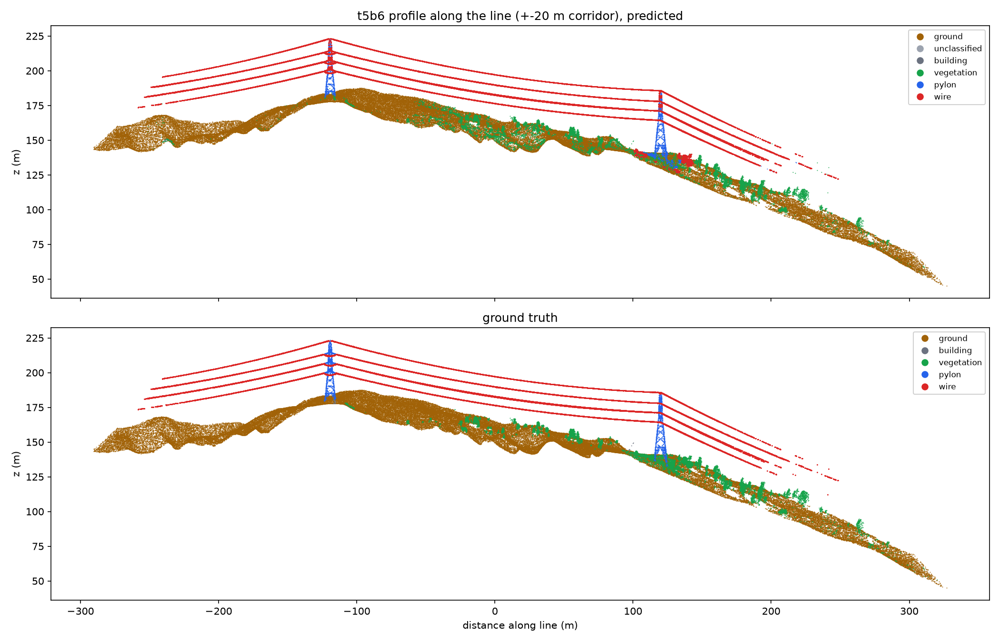
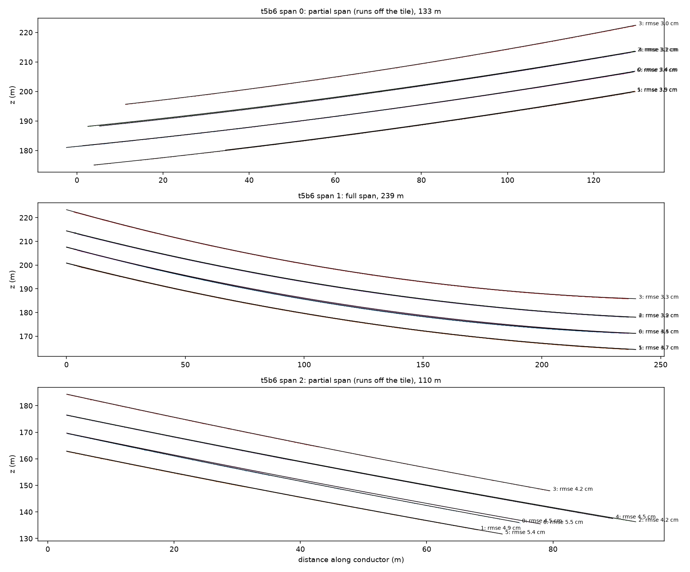
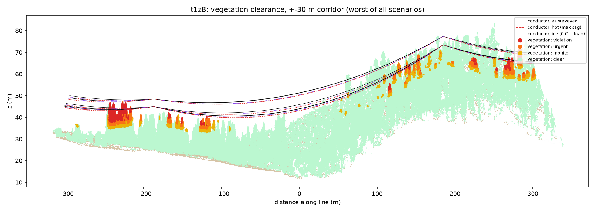
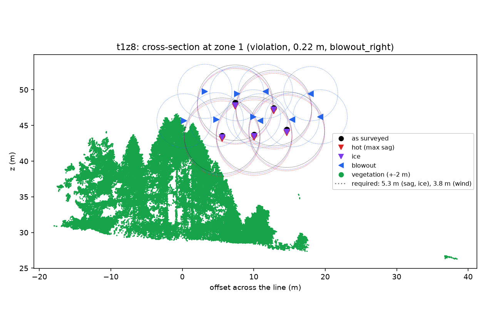

# Tree-to-line clearance from LiDAR

How close is the vegetation to a power line, and will it still be clear on a hot day or in
a strong wind? This pipeline answers that from a raw LiDAR point cloud, in three phases:

- **Phase 1**: classify the cloud into ground, vegetation, wires, pylons and buildings.
- **Phase 2**: find the towers, build a graph of towers and the spans between them (several
  lines and junctions per tile), and fit a catenary to every conductor.
- **Phase 3**: vegetation clearance as surveyed, hot, iced and in wind, to the Swiss
  Leitungsverordnung (LeV) thresholds; tiered encroachment zones; hazard (fall-in) trees;
  where wire could not be modelled, which vegetation was not assessed.

Plain Python (NumPy, SciPy, laspy), rule-based and physics-based, no trained model. Checked
against hand-labelled drone LiDAR of high-voltage lines in Switzerland
([GridNet-HD](#data-and-credit)): two alpine tiles, two forest tiles with trees growing into
the line (one held out), a tile on another line with a junction, and two neighbouring tiles
joined into one.

## Results at a glance

Every number is scored against the dataset's hand labels. Phase 3 is scored **end to end**:
the reference is a run built entirely from the hand labels (conductor model fitted to the
hand-labelled wire, hand-labelled vegetation), compared point by point with our run.

**Held-out test (t1z8).** Run on the committed code (`d651e4b`) before any of the later
changes, with that version's placeholder thresholds (3 m), never looked at while developing:

| t1z8, forest, 51 M points | Result |
|---|---|
| 1. Wires found (recall / IoU) | 99.5% / 0.82 |
| 2. Towers / conductors (hand labels) | 2 / 15 (2 / 15), conductors within 0.1 cm of the hand-label fit |
| 3. Encroachment zones | **34 of 34 found, no false ones, all in the same tier**, clearance within 2 cm |
| 3. Flagged vegetation points (precision / recall) | 99.9% / 100% |
| 3. Hazard trees (precision / recall) | 98% / 96% |

**Current version, Swiss rules** (380 kV: 5.3 m to trees in the hot and ice cases, 3.8 m
in wind; see [Phase 3](#phase-3-vegetation-clearance-scenariospy-encroachpy-hazardpy)):

| | t1z8: forest | t1z6a: forest | t2z5: junction | t5b6: alpine |
|---|---|---|---|---|
| Points | 51 M | 50 M | 67 M | 36 M |
| 1. Wires found (recall / IoU) | 99% / 0.82 | 99% / 0.69 | 99% / 0.81 | 97% / 0.79 |
| 2. Towers found (true towers) | 2 (2) | 3 (3) | 6 (6), within 2.6 m | 2 (2) |
| 2. Conductors (hand-label model) | 15 (15) | 20 (21) | 40 (37) | 22 (22) |
| 3. Closest vegetation as surveyed (hand labels) | 2.80 m (2.80) | 1.17 m (1.17) | 1.21 m (1.21) | 8.39 m (8.39) |
| 3. Zones: ours (reference) | 63 (63) | 43 (44) | 74 (75) | 1 (1) |
| 3. Zones precision / recall / same tier | **100% / 100% / 63 of 63** | 100% / 98% / 43 of 43 | 99% / 100% / 73 of 76 | 100% / 100% / 1 of 1 |
| 3. Flagged vegetation points (precision / recall) | 99.9% / 100% | 97% / 97% | 97% / 97% | 100% / 100% |
| 3. Hazard trees (precision / recall) | 97% / 97% | 88% / 97% | 89% / 96% | none exist |
| 3. Wire not modelled (vegetation beside it not assessed) | none | 12 m | **896 m** | none |

- **t1z8** is held out only in the first table; the second shows the same tile with
  everything since (Swiss rules, crowns, sag-tension).
- **t1z6a** (forest: towers fused with the canopy, conductors bridged by stray points) and
  **t2z5** (a junction: four towers within 60 m, a second line leaving) were both fixed on,
  so they are not held out. On t2z5 the reference is weak too: it is our own Phase 2 run on
  the hand-labelled points, and it fails to model some junction conductors that we model
  from hand-labelled wire; its numbers are not ground truth there.
- t2z5 has 896 m of wire with no conductor model; the report lists each stretch and the
  vegetation beside it as **not assessed**, instead of reporting that vegetation as clear.

Details per phase below.

**Phase 1**: predicted classes (top) against the hand labels (bottom), along the line.



**Phase 2**: catenaries (black) fitted to each conductor's points, per span: a double
circuit (2 x 3 phases) plus an earth wire.



**Phase 3**: the held-out forest line, Swiss rules. Vegetation coloured by its worst case
(as surveyed, hot at 40 C, iced, or swung by wind) against the required distance: red is
inside it, orange within 1.5 m of it, yellow on the 3-year watch list.



Cross-section at the worst zone: each conductor as surveyed (black), hot (red), iced
(violet) and swung 44 degrees by a 500 N/m2 wind (blue), with the required distances (5.3 m
hot and iced, 3.8 m in wind). In wind the conductors swing about 5 m sideways; the lower
one on the left comes to 0.22 m from the tallest crowns.



## Run

```bash
uv venv --python 3.12 .venv
uv pip install --python .venv -r requirements.txt
.venv/Scripts/python -m pytest   # Windows path; bin/ on macOS/Linux
```

Get the GridNet-HD tiles used here (1.2-2.5 GB each, 11 GB in all; see
[Data and credit](#data-and-credit)). Large downloads from Hugging Face sometimes drop;
`-C -` resumes them.

```bash
mkdir -p data
for z in t5c2 t5b6 t1z6a t1z6b t1z8 t2z5; do curl -L -C - -o data/$z.las https://huggingface.co/datasets/heig-vd-geo/GridNet-HD/resolve/main/$z/lidar/$z.las; done
```

Run all three phases on one or more tiles, with a summary row per tile in
`out/batch_summary.md` (or `run_phase1 --synthetic` for the generated corridor).
`a.las+b.las` joins neighbouring tiles into one, so spans cut by the tile edge are whole:

```bash
.venv/Scripts/python -m scripts.run_batch data/t1z8.las data/t2z5.las data/t1z6a.las+data/t1z6b.las --truth-field ground_truth --truth-map gridnet [--kv 380 --t-survey 15 --t-max 40 --wind-pa 500]
```

Each phase also runs on its own: `scripts.run_phase1 <tile.las>`, then `run_phase2` and
`run_phase3` on the `<name>_classified_voxels.las` that Phase 1 writes. Phase 1 also writes
`<name>_report.md/.json` (scores + confusion matrix) and plan, profile and 3D plots.

To find zones worth downloading, `scripts.screen_zones --remote <zone> ...` reads ~2% of
each zone's file by HTTP byte range (about 40 MB instead of 2 GB) and reports how close
hand-labelled vegetation comes to the wires (see [Finding a zone](#finding-a-zone-with-trees-near-the-line)).

## Data and credit

The LiDAR data is [GridNet-HD](https://huggingface.co/datasets/heig-vd-geo/GridNet-HD)
(HEIG-VD), licensed [CC BY 4.0](https://creativecommons.org/licenses/by/4.0/): UAV LiDAR
and imagery of high-voltage lines with per-point labels. This project uses zones t5c2
(30.6 M points, 268 x 581 m, 236 m relief), t5b6 (36.1 M points, 328 x 747 x 223 m), t1z6a
(50.3 M points, 213 x 610 x 91 m, forest), t1z6b (51.5 M points, 238 x 614 x 105 m, the
neighbour of t1z6a), t1z8 (50.6 M points, 216 x 683 x 83 m, forest, validation split, the
held-out test) and t2z5 (66.7 M points, 515 x 680 x 162 m, a line junction). The data is
not included in this repository, and the plots in `docs/` are derived from it.

> Antoine Carreaud, Shanci Li, Malo De Lacour, Digre Frinde, Jan Skaloud, Adrien Gressin.
> *GridNet-HD: A High-Resolution Multi-Modal Dataset for LiDAR-Image Fusion on Power Line
> Infrastructure.* arXiv:2601.13052, 2026. https://arxiv.org/abs/2601.13052

## Phase 1: classification (`ground.py`, `features.py`, `classify.py`)

1. `io.voxel_downsample`: 0.15 m voxels (30.6 M -> 5.5 M points); labels are copied back
   to every original point at the end.
2. `ground.pmf_dtm`: progressive morphological filter on a 0.5 m min-z raster -> DTM ->
   height above ground (HAG). Points under 0.5 m HAG are ground.
3. `features`: eigenvalue features over 16 neighbours (linearity, planarity, scattering,
   main-direction and normal z) and `gap_below`, the empty space under each point's
   vertical run in its 0.5 m column.
4. `classify`:
   - **wires**: HAG > 3 m, linear, main direction < ~37 deg from horizontal, > 1 m of air
     below; clusters must be >= 15 m long and 4x longer than wide. Then short pieces aligned
     with nearby wires (sparse spans) and region growing into linear neighbours.
   - **pylons**: clusters >= 10 m tall, scattering < 0.14 (lattice, not crown), top within
     3 m of a wire and at least as high as the wires there. Points more than 15 m from the
     tower centre are handed back (wires the voxel grid joined to the tower).
   - **buildings**: smooth (scattering < 0.05) mostly planar clusters, >= 2 m wide.
   - **vegetation**: everything else above ground.

### Results on t5c2 (tuning tile)

Full resolution, every point scored against GridNet-HD labels (grass, rock, road -> ground;
insulators -> pylon; conductors and structural cables -> wire).

| class | precision | recall | IoU |
|---|---:|---:|---:|
| ground | 0.990 | 0.997 | 0.987 |
| vegetation | 0.420 | 0.738 | 0.365 |
| building | 1.000 | 0.582 | 0.582 |
| pylon | 0.991 | 0.952 | 0.944 |
| wire | 0.965 | 0.982 | 0.948 |

Overall accuracy 0.983; runtime about 1 minute on a laptop.

### Held-out check: t5b6 (thresholds unchanged)

Zone t5b6 (36.1 M points, 328 x 747 x 223 m, bigger towers, more trees) was never looked at
while tuning. Same parameters:

| class | precision | recall | IoU | (t5c2 IoU) |
|---|---:|---:|---:|---:|
| ground | 0.990 | 0.977 | 0.968 | 0.987 |
| vegetation | 0.632 | 0.781 | 0.537 | 0.365 |
| building | 0.000 | 0.000 | 0.000 | 0.582 |
| pylon | 0.939 | 0.918 | 0.867 | 0.944 |
| wire | 0.803 | 0.974 | 0.786 | 0.948 |

- Wire recall holds (97%); precision drops to 80%. The false wires are mostly pylon members
  (38k points): these towers are wider than the 15 m `pylon_radius`, so their outer parts are
  handed back as wires. 7k vegetation points also became wire.
- The tile has almost no buildings (9k points); the 62k "building" predictions are smooth
  ground and rock above the DTM.
- Phase 2 absorbs the wire false positives (see below), so the geometry is unaffected. For a
  Phase 1 fix: size `pylon_radius` from each tower's own footprint instead of a constant.

### Forest: t1z6a (thresholds unchanged)

| class | precision | recall | IoU |
|---|---:|---:|---:|
| ground | 0.949 | 0.887 | 0.847 |
| vegetation | 0.880 | 0.950 | 0.842 |
| building | 0.619 | 0.453 | 0.354 |
| pylon | - | 0.000 | 0.000 |
| wire | 0.689 | 0.992 | 0.685 |

- **No pylons found.** Each tower stands in trees as tall as it is (vegetation 95th
  percentile 21.5 m, towers 22 m), so on the 1 m connectivity grid a tower and hundreds of
  metres of canopy form one cluster (2.6-3.1 M points) that scatters like forest (0.28-0.31,
  vs 0.11 for tower steel). Tower points become vegetation (270k) or wire (97k).
  A per-point scattering filter before clustering was tried and rejected: it broke the
  alpine towers (recall 0.95 -> 0.69) and let tree fragments pass as towers here.
  Phase 2 finds these towers from the wires instead (below), so the clearance answer does
  not depend on Phase 1 getting them.
- Wires: 99% recall; the false wires are mostly that tower steel.

### Held-out forest: t1z8 (committed code, never tuned on)

| class | precision | recall | IoU |
|---|---:|---:|---:|
| ground | 0.957 | 0.876 | 0.843 |
| vegetation | 0.901 | 0.957 | 0.866 |
| building | 0.051 | 0.414 | 0.048 |
| pylon | 0.994 | 0.478 | 0.477 |
| wire | 0.825 | 0.995 | 0.822 |

Half of the tower steel is found here (the rest becomes vegetation or wire, as on t1z6a).
Buildings are poor: 458k points predicted against 57k true, mostly smooth ground and rock
above the terrain model; they play no part in the clearance results.

Caveats:
- t5c2 numbers are tuned-on-the-data; t5b6 is the honest estimate.
- Vegetation here is tiny (0.7% of points, mostly shrubs under 1 m), so its precision is
  dominated by rough ground and building edges labelled vegetation. Low vegetation can't
  reach the wires; Phase 3 should only consider vegetation above a few metres.
- A tree that has grown into the wires could be absorbed into a pylon cluster only if it is
  also lattice-smooth and within 15 m of a tower; worth a dedicated check in Phase 3.

## Phase 2: conductor model (`graph.py`, `spans.py`, `catenary.py`)

A tile can hold several lines and junctions, so towers and spans form a graph
(`graph.build_line_graph`). The first version ordered towers along one axis and cut one
route into spans; at the t2z5 junction (four towers within 60 m, a second line leaving) it
found 3 of 6 towers and modelled conductors through the junction.

1. **Towers**, from three sources, merged within 8 m (earlier source wins):
   - *pylon clusters*: connected pylon points (>= 200 voxels), pieces within 10 m merged;
   - *kinks*, per direction group: wire points are grouped by their direction in plan
     (circular histogram peaks), and for each group the conductors' upper envelope (90th
     percentile of wire z per 1 m) must kink downwards (slope 15 m before minus 15 m after
     > 0.03; a catenary alone gives a negative value; both sides >= 80% covered, so not on
     the last metres before a tile edge, where a tree at wire height once passed as a tower)
     **and** the line's centre column
     (2.5 m radius, between the lowest conductor - 3 m and the top wire - 1 m, slid +-8 m)
     must hold >= 300 points that are neither ground nor wire. At mid-span that column is
     open air (vegetation must stay below the conductors); a tower body fills it. Kinks
     alone fire at tile edges and where the envelope switches conductor: true towers had
     2,300-7,300 centre-column points, false kinks 0-59.
   - *direction changes*: wires do not bend in mid-air. Where wire points within 6 m (3D)
     run in clearly different plan directions (doubled-angle mean resultant < 0.9, about
     26 degrees), there is an angle or junction tower. A candidate where every direction
     carries on past it is a **crossing** of two lines, not a tower, and is dropped (t2z5
     had one on its main span).
   - *terminals* (second pass): a partial span >= 30 m long that stops while the survey goes
     on (ground beyond) at structure at wire height ends on a terminal tower. Not at a tile
     edge (no ground beyond), nor within 25 m of a known tower (jumper pieces), and the
     structure must be steel-shaped: median scattering <= 0.2 (lattice ~0.11, crowns ~0.28).
     In t2z5 a line leaving the survey among trees as tall as the wires passed every other
     test; Phase 1 labels forest towers vegetation anyway, so labels cannot decide it.
   On the five tiles every true tower is found, within 0.0-2.6 m; no false ones. Moving
   wire-found towers onto the densest "steel" column was tried and pulled forest towers
   8-9 m off, onto the canopy.
2. **Spans** (graph edges):
   - two towers are joined if wire points running along the line between them (within
     12 m) cover >= 60% of it, in its direction: within 20 degrees, or atan(20 m / span
     length) on short spans. Conductors hang from cross-arm ends up to ~10 m either side of
     a tower centre, so on the 15 m span at the t2z5 junction they run at ~50 degrees to the
     line between the centres; with a fixed 20 degrees that span was missed;
   - an edge is a bypass, and dropped, if a third tower lies within its 12 m corridor, or
     forms a triangle of edges with it while lying within 15% of its length of the line
     (t1z6a's 389 m bypass passed the middle tower at 12.07 m);
   - wire points go to the nearest edge, only beside it (not past its towers), aligned or
     next to a tower;
   - wire leaving a tower that no edge explains becomes a partial span (a ray) to where it
     stops; wire near no tower becomes a tower-less span.
   Spans between two towers are *full*, the rest *partial*.
3. **Conductors**: in each span, cluster (DBSCAN, eps 0.5 m) on lateral offset and height
   above a common quadratic. Parallel wires keep a constant offset, so each collapses to a
   blob however patchy it is along the span. Bundled sub-conductors stay one conductor.
   Points within 3 m of a tower are left out first: clamps, insulator strings and jumpers
   hang there and bend away from the catenary.
   A conductor is modelled only where its data reaches: it counts as reaching a tower only if
   its points come within 8 m of it, otherwise the model stops where the data stops. In t2z5
   two wires of a parallel line stopped 53 m short of the span's tower; modelled to the
   tower, they ran through the trees and created false zones.
4. **Catenary** per conductor, in its own vertical plane:
   `z(u) = z0 + c (cosh((u - u0)/c) - 1)`, robust least squares (soft-L1, 10 cm scale),
   started from a parabola fit, then up to two refits without points more than
   max(0.5 m, 3 robust sigma) off. `c = H/w` (horizontal tension / weight per metre).
   Reported: c, sag below the chord (full spans), fit RMSE (vertical and lateral), coverage,
   lowest ground clearance along the wire, outliers dropped.
5. **Validation**: a cluster is rejected (listed with the reason in the report) if it has
   too few points (3 per metre, capped at 100), is < 10 m long, covers < 50% of its extent,
   has c at a fit bound, a vertical RMSE > 25 cm (real conductors fit to ~5 cm), did not
   converge, or is a piece < 30 m in a tower's span that does not reach the tower (wire
   leaving a tower starts at it; in t1z6a such a 13 m piece of jumper, vegetation and
   unlabelled points was 0.69 m from a tree, 8 m from any real wire). This is what removes
   the clusters made of Phase 1's false wire points. A large cluster rejected for
   RMSE is first re-clustered at half the radius (down to 0.125 m) and the pieces refitted:
   in the forest tile, stray tower points bridged two conductors into one 6,671-point
   cluster with a 2.65 m RMSE.
6. Outputs: `<name>_phase2.json`, `<name>_conductors.csv`, `<name>_conductor_model.las`
   (every conductor sampled at 0.25 m, the input for Phase 3), `<name>_spans.png`
   (points + fitted curves per span), `<name>_route.png` (plan).

### Results

Alpine tiles: 2 towers, one full span and partial spans to the tile edges, 7 conductors per
span: a double circuit (2 x 3 phases) plus an earth wire. Forest tiles: 2-3 towers (found
from the wires), 5 conductors per span. Junction tile: 6 towers, 14 spans (5 full, from
15 m to 359 m).

| | t5c2 | t5b6 | t1z6a (forest) | t1z8 (forest, held out) | t2z5 (junction) |
|---|---|---|---|---|---|
| towers found (true) | 2 (2) | 2 (2) | 3 (3) | 2 (2) | 6 (6) |
| spans (full) | 3 (1) | 5 (1) | 5 (2) | 3 (1) | 14 (5) |
| conductors (hand-label model) | 21 (21) | 22 (22) | 20 (21) | 15 (15) | 40 (37) |
| conductors matching the hand-label model | 21 | 22 | 20 | 15 | 38 |
| vertical RMSE, all conductors | 2.8-5.0 cm | 3.0-6.3 cm | 2.7-4.0 cm | 2.3-3.0 cm | 2.3-20 cm |
| height difference to the hand-label model, median / max | 0.0 / 1.7 cm | 0.5 / 2.6 cm | 0.0 / 0.2 cm | 0.0 / 0.1 cm | 0.1 / 52 cm |

- Without the wire-found towers, the forest tile gave 0 towers, one 600 m "span" and no
  usable conductor; without the re-clustering, 18 of its 20 conductors.
- With the graph, t5b6's steep partial span is modelled as far as the hand-label model
  (before: 30 m short, see Phase 3).
- t2z5: the 52 cm difference and the unmatched conductors are at the junction, where the
  hand-label model itself fails to model some conductors; our extra conductors there are
  made entirely of hand-labelled wire.

**Classification errors barely move the geometry**: even on t5b6, where 20% of predicted
wire points are wrong, every conductor fitted from predicted points is within 3.8 cm of the
one fitted from hand-labelled points. On partial spans c itself can differ by a few percent
(a 40-130 m piece of a span constrains it weakly) while the curve over the covered stretch
still agrees to centimetres.

Note: the tower margin, residual trim and validation rules were added after the first
t5b6 run showed tower hardware and false wires spoiling fits, and the wire-found towers and
re-clustering after the first t1z6a run, so Phase 2 numbers on those tiles are no longer
strictly held out. Phase 1's t5b6 and t1z6a numbers are (Phase 1 was not changed).

Synthetic check (tests): c = 900 m and sag 2.35 m are recovered within 3% and 5 cm.

### Limits

- Partial spans: the model is only valid over the stretch with points; c is weakly
  determined. Joining neighbouring tiles fixes this (see [Joining tiles](#joining-neighbouring-tiles)).
- Bundled conductors would be modelled at the bundle centre. The lateral and vertical fit
  RMSE (2-5 cm) on these lines shows single conductors, so Phase 3 subtracts only the
  conductor radius.
- Graph: a terminal tower is only found at the end of a partial span >= 30 m long, so a
  terminal within 25-30 m of the previous tower stays a partial span (tested). Several
  parallel lines sharing towers are not told apart.
- The fit is the line *as surveyed*. Max sag (hot conductor) and blowout (wind) are Phase 3.

## Phase 3: vegetation clearance (`scenarios.py`, `encroach.py`, `hazard.py`)

### Rules: Swiss Leitungsverordnung (LeV, SR 734.31)

The lines are in Switzerland, so the defaults follow the LeV for high-voltage overhead lines
(Starkstromfreileitungen), read from the official text (Fedlex):

| What | LeV | Used here |
|---|---|---|
| Vertical distance trees - bare conductors at greatest sag | Art. 35(4)b: 1.5 m + 0.01 m/kV (fruit trees 2.5 m + 0.01 m/kV) | **5.3 m** at 380 kV (3.7 m at 220 kV), as a 3D distance in the hot and ice cases |
| Greatest sag | Art. 47: the worse of 40 C, and 0 C with 20 N/m extra load (snow/ice) per conductor or sub-conductor, no wind | two scenarios: *hot* (40 C) and *ice* (0 C + 20 N/m) |
| Wind deflection | Definitions no. 37: conductor at 10 C; Annex 4: 500 N/m2 on wires | *blowout left/right* at 10 C, 500 N/m2: a 44 degree swing |
| Direct distance to trees in wind | Art. 35(1): case by case | **3.8 m** by analogy with Art. 34(2) (terrain beside the line in wind: 0.01 m/kV, at least 1.5 m) |

The nominal voltage is not in the data: 380 kV is assumed (`--kv`; 220 kV gives 3.7 m and
2.2 m). Operators may rate a line hotter than 40 C (`--t-max`). The conductor is a typical
AAAC/Aldrey (AlMgSi) 600 mm2 class conductor (d 31.9 mm, 16.3 N/m, EA 34 MN, alpha 23e-6/C),
the kind used on Swiss lines; not the line's datasheet. Growth (1 m/yr) and the trimming
cycle (3 years) are assumptions. All are parameters (`Rules`, `LineParams`).

### Method

1. **Scenarios** per conductor, sampled every 0.1 m over its modelled extent:
   - *as surveyed*: the Phase 2 catenary;
   - *hot*, *ice*, *wind*: the conductor's horizontal tension at the survey (H = c w, from
     its fitted catenary) is carried to the scenario's temperature and load with the
     change-of-state equation of its span, which includes the elastic relief of a hotter
     or loaded wire (a hotter wire also loses tension, so it stretches less):
     `H2^2 [H2 - H1 + EA w1^2 L^2 / (24 H1^2) + EA alpha (t2 - t1)] = EA w2^2 L^2 / 24`.
     The new catenary (c = H2 / w2) passes through the same attachment points. In wind the
     loaded curve (w2 = resultant of weight and wind) swings about its chord by
     atan(wind load / weight). Parabolic, per actual span, no creep, no ruling span; with an
     infinitely stiff conductor it reduces to pure thermal elongation (tested).
   - Attachment points come from what each conductor's data reaches: both towers -> exact;
     one tower and >= 30 m of data -> the far attachment is extrapolated along the fitted
     curve at the median full-span length, flagged `estimated`; otherwise (a short piece, or
     no tower) -> checked as surveyed only (`conductors_not_assessed_for_sag_wind`).
     Extrapolating 15 m pieces over a 270 m span swung them metres sideways in the wind
     case, into trees nowhere near the real wire.
2. **Vegetation cleaning** (Phase 1 errors would otherwise become false alarms):
   - *near towers*: vegetation-labelled points within 8 m (in plan) of a tower centre. In
     t1z6a the only 3 false zones were hand-labelled tower steel 3-6 m from a tower centre
     (every real zone was >= 30 m from a tower). The cost: a tree inside a tower footprint
     is not reported; tower surroundings need their own check.
   - *floating fragments*: vegetation clusters (1 m connectivity) with < 200 points and
     nothing below 3 m above ground. Plants grow from the ground; every false zone they
     caused on the alpine tiles was hand-labelled conductor.
   - *on-conductor points*: within 0.5 m of the conductor model with >= 80% of their 1 m
     neighbourhood also on it. A crown touching the wire keeps its contact points (the
     crown behind them is in their neighbourhood); tested.
3. **Clearance**: 3D distance from each vegetation point to the nearest conductor (axis
   minus conductor radius), per scenario, against that scenario's required distance. The
   scenario with the smallest margin governs; tiers by margin: violation < 0 <= urgent <
   1.5 m <= monitor < growth x cycle (3 m).
4. **Encroachment zones**: flagged points clustered (1 m connectivity); per zone the tier,
   governing scenario, clearance, required distance and margin, the minimum in every
   scenario, nearest span/conductor, horizontal and vertical offset, location, point count,
   plan area, years to violation. Sorted worst first.
5. **Unmodelled wire**: wire-labelled points more than 1 m from every conductor model,
   grouped into line-shaped stretches >= 10 m away from towers, with the number of
   vegetation points within the watch distance of each: listed as **not assessed**
   (`<name>_unmodelled_wire.csv`), instead of silently counting that vegetation as clear.
6. **Hazard trees**: treetops = local maxima (3 m window) of a 0.5 m canopy height model,
   >= 3 m tall. Each vegetation point goes to its nearest treetop (within 0.4 h + 2 m),
   giving the crown radius (spread of the upper half) and the base (where the low points
   stand, if >= 10; else vertical), so a leaning tree pivots at its real base. Reach =
   sqrt(stem^2 + crown radius^2) from the base, in any direction (a sphere, so downhill
   falls are included): `strike` if the reach touches a conductor in any scenario,
   `within_mvcd` if it comes within the wind distance (3.8 m). Which way a leaning tree
   will fall is not modelled.
7. Outputs: `<name>_phase3.json`, `<name>_encroachments.csv` / `.geojson` (zone hulls, in
   the tile's projected CRS: assign it in GIS), `<name>_hazard_trees.csv`,
   `<name>_unmodelled_wire.csv`, `<name>_vegetation_clearance.las` (fields `clearance`,
   `tier`), plots `_clearance_profile`, `_clearance_plan`, `_clearance_section`.

### Results

Scoring (`clearance/validate3.py`), against the hand labels on the same voxels. Flagged
points are compared by index; a predicted zone matches a reference zone if they share a
point; hazard trees match within 2 m in plan.
- **End to end**: reference = conductor model fitted to the hand-labelled wire +
  hand-labelled vegetation. Covers classification and conductor modelling, not the sag
  and wind assumptions (both runs use the same ones).
- **Same model** (in the reports): our conductor model with hand-labelled vegetation.
  Isolates Phase 1's vegetation errors, but is blind to a wrong conductor model: on t2z5
  before the graph it showed 90% / 100% zones while end to end was 77% / 82%.

With the Swiss rules (380 kV):

| | t5c2 | t5b6 | t1z6a (forest) | t1z8 (forest) | t2z5 (junction) |
|---|---|---|---|---|---|
| ours: closest vegetation surveyed / hot / ice / wind | 9.24 / 8.56 / 8.94 / 9.82 m | 8.39 / 7.66 / 8.00 / 10.30 m | 1.17 / 0.82 / 0.98 / 0.45 m | 2.80 / 2.58 / 2.68 / 0.22 m | 1.21 / 1.18 / 1.23 / 0.78 m |
| reference (all hand labels) | 12.05 / 11.67 / 11.87 / 12.64 m | the same | 1.17 / 0.82 / 0.98 / 0.44 m | 2.80 / 2.58 / 2.68 / 0.23 m | 1.21 / 1.99 / 2.01 / 2.00 m |
| zones violation / urgent / monitor, ours (reference) | 0 (0) | 0 / 0 / 1 (0 / 0 / 1) | 14 / 9 / 20 (14 / 10 / 20) | 16 / 14 / 33 (16 / 14 / 33) | 28 / 17 / 29 (30 / 16 / 29) |
| zones precision / recall | | 1.0 / 1.0 | 1.0 / 0.98 | **1.0 / 1.0** | 0.99 / 1.0 |
| same tier (matched pairs) | | 1 / 1 | 43 / 43 | **63 / 63** | 73 / 76 |
| flagged points precision / recall | | 1.0 / 1.0 | 0.97 / 0.97 | 1.0 / 1.0 | 0.97 / 0.97 |
| hazard trees precision / recall (reference count) | | | 0.88 / 0.97 (73) | 0.97 / 0.97 (74) | 0.89 / 0.96 (121) |
| governing scenario of the zones | | hot | hot 38, wind 4, surveyed 1 | hot 44, wind 19 | hot 57, surveyed 10, wind 6, ice 2 |
| wire not modelled (vegetation beside it, not assessed) | none | none | 12 m (34,682 points) | none | 896 m (56,665 points) |
| conductors checked as surveyed only | 0 of 21 | 1 of 22 | 0 of 20 | 0 of 15 | 5 of 40 |

- **Held out (t1z8)**, on the committed code before these changes and with that version's
  3 m placeholder thresholds: 34 of 34 zones, all in the same tier, clearance within 2 cm;
  flagged points 99.9% / 100%; hazard trees 98% / 96% ([Results at a glance](#results-at-a-glance)).
- The hot case governs most zones; the wind case matters where trees stand beside the
  line (t1z8: a 44 degree swing brings a conductor to 0.22 m of a crown). The ice case is
  milder than the hot case on these spans: cooling from 15 C to 0 C shortens the wire,
  partly cancelling the 20 N/m (on a 130 m span: 2.35 m sag surveyed, 2.51 m iced, 2.93 m
  at 40 C; checked by hand calculation in the tests).
- **Survey temperature** (unknown, assumed 15 C) on t1z8: at 5 / 15 / 25 C the closest hot
  clearance is 2.47 / 2.58 / 2.66 m, the closest wind clearance 0.14 / 0.22 / 0.37 m, and
  violations 17 / 16 / 14. A colder assumption is the safe side.
- t1z6a: our closest point as surveyed was 0.69 m against the reference's 1.19 m; it was a
  13 m piece of jumper, vegetation and unlabelled points just past a tower, now rejected
  (Phase 2 validation). Both are now 1.17 m.
- t2z5: the reference fails to model some junction conductors that we model from
  hand-labelled wire; its larger hot and wind clearances (1.99 m and 2.00 m against our
  1.18 m and 0.78 m) come from conductors it does not have. 896 m of wire has no model in
  our run and is listed as not assessed.
- Hazard-tree precision fell on the forest tiles with crown width and lean (t1z6a 94% to
  88%): a wider reach flags more borderline trees; recall stays at 96-97%.
- Alpine tiles: the line is well clear. Before the vegetation cleaning, t5c2 showed 3 zones
  and t5b6 8 zones plus 10 "strike" trees, all hand-labelled conductor or tower points that
  Phase 1 called vegetation.

### Limits

- Thresholds: the voltage, the conductor and the operating temperature are assumed, not
  read from the line's records; growth and the trimming cycle are assumptions. Art. 35 sets
  a vertical distance; it is applied here as a 3D distance (stricter beside the line).
- Sag-tension is parabolic per actual span: no ruling span (suspension insulators let
  tension equalise between spans), no creep, no insulator swing.
- One survey temperature for the whole flight (sensitivity above).
- The end-to-end reference is our own Phase 2 on hand-labelled points; at junctions it is
  itself imperfect.

## Joining neighbouring tiles

A span cut by a tile edge has an estimated far attachment, so its hot, iced and wind
positions are estimates. `io.read_many` (Phase 1 with several inputs, or `a.las+b.las` in
`run_batch`) loads neighbouring tiles onto one origin and processes them as one cloud.
t1z6a and t1z6b (102 M points together) overlap and share two towers:

| | t1z6a alone | t1z6b alone | joined |
|---|---|---|---|
| towers | 3 | 4 | 5 |
| spans (full) | 5 (2) | 5 (2) | 11 (4) |
| partial-span conductors | 10 | 10 | 14 (20 separately) |
| zones relying on an estimated attachment | 7 of 43 | 25 of 79 | 19 of 111 (32 separately) |
| end to end: zones precision / recall | 1.0 / 0.98 | 1.0 / 1.0 | 0.98 / 1.0 |
| end to end: same tier (matched pairs) | 43 / 43 | 80 / 82 | 110 / 112 |
| conductors checked as surveyed only | 0 | 0 | 4 |

Joining cuts the zones that rely on an estimated attachment by about 40%, with the same
agreement with the hand labels. The joined run also leaves 4 short conductor pieces checked
as surveyed only (none separately); not yet investigated. The test splits the synthetic
corridor through a span and checks it is partial on its own and full when joined.

## Finding a zone with trees near the line

The first two tiles had no vegetation near the line, so Phase 3 could not be checked on real
encroachments. `scripts/screen_zones.py` finds candidate zones without downloading them:
`clearance/sample.py` reads the LAS header and then ~2% of the points as 2,000 evenly spaced
chunks, by HTTP byte range, and measures how close hand-labelled vegetation comes to
hand-labelled wire.

- Chunk count matters more than sample size: points are not stored in a spatially uniform
  order, so 300 chunks put t5b6's closest vegetation at 19.7 m, 2,000-3,000 chunks at
  8.9-9.2 m (full file: 8.4 m).
- Only the 27 train/validation zones carry labels (test-zone labels are withheld). 16 were
  screened (about 40 MB and 2.5-6 minutes each). Vegetation within 5 m of a wire:

| zone | closest (sample) | | zone | closest (sample) |
|---|---:|---|---|---:|
| t1z6a | 1.7 m | | t4z1 | 3.7 m |
| t1z6b | 2.5 m | | t1z5b | 4.2 m |
| t1z8 | 3.0 m | | t6z2, t6z3 | 5.3 m |
| t2z5 | 3.3 m | | t5a4, t5b1, t3*, t6z4, t6z6 | 8-52 m |

## Licence

Code: [MIT](LICENSE). Data and the plots derived from it: GridNet-HD, CC BY 4.0 (see
[Data and credit](#data-and-credit)).
